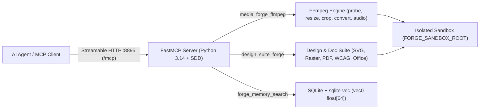
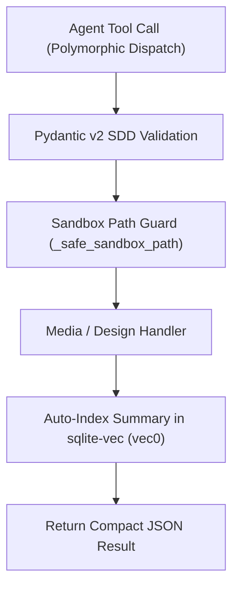

# studio-forge-mcp

> **Unified MCP Creative, Media & Document Editing Forge** — isolated **FFmpeg** multimedia pipelines, **SVG / raster / document** transformations, **Code Mode** polymorphic dispatch, **Schema-Driven Development (SDD)**, and **`sqlite-vec` semantic memory**.

---

## What Is This?

`studio-forge-mcp` is a standalone **Model Context Protocol (MCP)** server designed for AI coding and design agents that need reliable, sandboxed **media, vector, and document editing** without bloating LLM context windows.

Instead of exposing dozens of single-action tools, `studio-forge-mcp` groups domain capabilities behind **3 polymorphic tools** (`media_forge_ffmpeg`, `design_suite_forge`, `forge_memory_search`), strict **Pydantic v2** SDD contracts, path-traversal-guarded sandboxes, and local **`sqlite-vec` (`vec0`, `float[64]`)** vector recall.

> **Current Status (v0.1.0 Scaffold):** SDD schemas, sandbox path guards, `sqlite-vec` memory, `/health` endpoint, FastMCP Streamable HTTP transport, and Docker runtime are operational. `media_forge_ffmpeg` and `design_suite_forge` currently validate, guard paths, and index jobs (`status: "ready"`), with full subprocess execution and advanced Code Mode batching next on the roadmap.

---

## Architecture



---

## Code Mode & Token Efficiency

`studio-forge-mcp` adopts **Code Mode** principles to minimize tool-catalog bloat and LLM round-trips:

| Capability | Status | Details |
|---|---|---|
| **Polymorphic Domain Dispatch** | Implemented | 3 cohesive tools (`media_forge_ffmpeg`, `design_suite_forge`, `forge_memory_search`) replace 13+ single-purpose tools, keeping MCP tool schemas compact. |
| **Schema-Driven Development (SDD)** | Implemented | Pydantic v2 contracts (`src/studio_forge_mcp/schemas.py`) validate inputs at the boundary before any handler or subprocess runs. |
| **Sandboxed Path Normalization** | Implemented | `_safe_sandbox_path()` resolves every path inside `FORGE_SANDBOX_ROOT`, blocking `..` traversal and escaping symlinks. |
| **Semantic Auto-Indexing** | Implemented | Executed jobs are auto-indexed into `sqlite-vec` (`vec0` `float[64]`) for low-token recall via `forge_memory_search`. |
| **Batch DAG & Field Projection** | Planned | Multi-step single-turn batching (`$prev.*` piping), `select_fields` projection, and `verbosity` tiers (`terse` / `summary` / `detail`). |



---

## Toolset & Credits

### Multimedia Engine — Powered by [FFmpeg](https://ffmpeg.org/)
Full credit to the **[FFmpeg](https://ffmpeg.org/)** project for the underlying audio, video, and frame-processing engine exposed through `media_forge_ffmpeg`:
- `probe`: inspect streams, codecs, resolution, duration, and container metadata.
- `resize` / `crop`: deterministic dimension transforms with bounded SDD constraints (`1..16384`).
- `convert`: transcode across container/image formats.
- `extract_audio` / `waveform`: isolate audio tracks and generate visual waveform previews.

### Design, Vector & Document Suite (`design_suite_forge`)
- `svg_optimize` / `raster_to_svg`: clean and vectorize artwork for web and design tools.
- `extract_palette` / `wcag_contrast`: extract color palettes and verify WCAG accessibility ratios.
- `doc_extract` / `pdf_render_pages`: extract structured text/tables and render PDF pages (powered by Poppler and Python tooling).

### Semantic Artifact Memory (`forge_memory_search`)
- Powered by **`sqlite-vec` (`v0.1.9`, `vec0` `float[64]`)** with deterministic 64-dimensional character-trigram embeddings (`src/studio_forge_mcp/memory.py`) for instant, zero-external-API recall over past `media_job` and `design_job` runs.

---

## Quick Start

```bash
uv sync --group dev
uv run pytest -v
uv run studio-forge-mcp
```

### Docker (`python:3.14-slim`)

```bash
docker build -t studio-forge-mcp:0.1.0 .
docker run --rm -p 8895:8895 -v /tmp/studio-forge-sandbox:/sandbox studio-forge-mcp:0.1.0
```

Health endpoint: `GET http://127.0.0.1:8895/health`

---

## Installing in an MCP Ecosystem

`studio-forge-mcp` supports both **`stdio`** (for local desktop/IDE MCP clients such as Antigravity `~/.gemini/config/mcp_config.json`) and **Streamable HTTP** (for Docker or remote deployments on `FORGE_HOST:FORGE_PORT`, default `http://127.0.0.1:8895/mcp`).

### Option A: Local `stdio` Launcher (Recommended for Desktop/IDE Clients)

Register [`scripts/forge-mcp-launch.sh`](scripts/forge-mcp-launch.sh) in your `mcp_config.json`:

```json
{
  "mcpServers": {
    "studio-forge-mcp": {
      "command": "/home/ancruz/Documents/workspaces/studio-forge-mcp/scripts/forge-mcp-launch.sh",
      "disabled": false
    }
  }
}
```

### Option B: Streamable HTTP (Local or Docker)

1. Start the server (`uv run studio-forge-mcp` or `docker run -d --name studio-forge-mcp -p 8895:8895 -v /path/to/sandbox:/sandbox studio-forge-mcp:0.1.0`).
2. Register the HTTP endpoint in any Streamable HTTP-capable MCP client:

```json
{
  "mcpServers": {
    "studio-forge-mcp": {
      "url": "http://127.0.0.1:8895/mcp"
    }
  }
}
```

---

## Configuration

| Variable | Default | Description |
|---|---|---|
| `FORGE_HOST` | `0.0.0.0` | Server bind host |
| `FORGE_PORT` | `8895` | Streamable HTTP / health port |
| `FORGE_TRANSPORT` | `streamable-http` | MCP transport (`streamable-http` or `stdio`) |
| `FORGE_SANDBOX_ROOT` | `/tmp/studio-forge-sandbox` | Isolated root directory for media/design files (Docker: `/sandbox`) |
| `FORGE_MEMORY_DB` | `/tmp/studio-forge-sandbox/forge_memory.db` | SQLite + `sqlite-vec` database path (Docker: `/sandbox/forge_memory.db`) |

---

## Development & Branching

- **Branches**: `main` (stable releases) and `dev` (active development).
- **Quality checks**:

```bash
uv run pytest -v
uv run ruff check .
uv run mypy src tests
```
