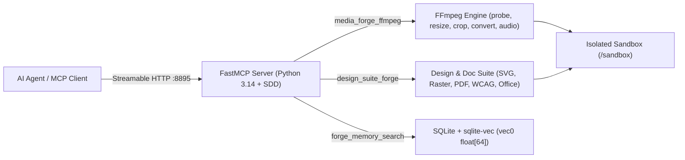
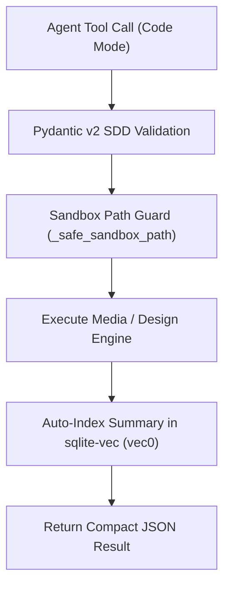

# studio-forge-mcp

> **Unified MCP Creative, Media & Document Editing Forge** — isolated **FFmpeg** multimedia pipelines, **SVG / raster / document** transformations, **Code Mode** batch orchestration, **Schema-Driven Development (SDD)**, and **`sqlite-vec` semantic memory**.

---

## What Is This?

`studio-forge-mcp` is a standalone **Model Context Protocol (MCP)** server designed for AI coding and design agents that need reliable, sandboxed **media, vector, and document editing** without bloating LLM context windows.

Instead of exposing dozens of single-action tools that force an agent into slow, token-heavy round-trips, `studio-forge-mcp` unifies domain capabilities behind **Code Mode** polymorphic tools, strict **Pydantic v2** SDD contracts, path-traversal-guarded sandboxes, and local **`sqlite-vec` (`vec0`, `float[64]`)** vector recall.

---

## Architecture



---

## Code Mode Improvements

`studio-forge-mcp` is built around **Code Mode** principles to maximize agent reliability and minimize token cost:

1. **Polymorphic Domain Dispatch**: Related operations are grouped into cohesive, strongly-typed tools (`media_forge_ffmpeg`, `design_suite_forge`, `forge_memory_search`) rather than sprawling tool catalogs.
2. **Schema-Driven Development (SDD)**: Every request and response is validated at the boundary with **Pydantic v2** (`src/studio_forge_mcp/schemas.py`), preventing malformed parameters before subprocesses or file handlers run.
3. **Sandboxed Path Normalization**: `_safe_sandbox_path()` resolves every input/output path inside `FORGE_SANDBOX_ROOT`, blocking directory traversal (`..`) and escaping symlinks.
4. **Compact Structured Returns & Semantic Auto-Indexing**: Tools return concise JSON summaries instead of raw verbose logs, and automatically index executed jobs into **`sqlite-vec`** so future sessions can recall prior transformations by semantic similarity.



---

## Toolset & Credits

### Multimedia Engine — Powered by [FFmpeg](https://ffmpeg.org/)
Full credit to the **[FFmpeg](https://ffmpeg.org/)** project for the underlying audio, video, and frame-processing engine exposed through `media_forge_ffmpeg`:
- `probe`: inspect streams, codecs, resolution, duration, and container metadata.
- `resize` / `crop`: deterministic dimension transforms with bounded SDD constraints (`1..16384`).
- `convert`: transcode across container/image formats.
- `extract_audio` / `waveform`: isolate audio tracks and generate visual waveform previews.

### Design, Vector & Document Suite (`design_suite_forge`)
- `svg_optimize` / `raster_to_svg`: clean and vectorize artwork for web and design tools.
- `extract_palette` / `wcag_contrast`: extract color palettes and verify WCAG accessibility ratios.
- `doc_extract` / `pdf_render_pages`: extract structured text/tables and render PDF pages (powered by Poppler, Pillow, and Python document libraries).

### Semantic Artifact Memory (`forge_memory_search`)
- Powered by **`sqlite-vec` (`v0.1.9`, `vec0` `float[64]`)** with deterministic 64-dimensional character-trigram embeddings (`src/studio_forge_mcp/memory.py`) for instant, zero-external-API recall over past `media_job` and `design_job` runs.

---

## Quick Start

```bash
uv sync --group dev
uv run pytest -v
uv run studio-forge-mcp
```

### Docker (`python:3.14-slim`)

```bash
docker build -t studio-forge-mcp:0.1.0 .
docker run --rm -p 8895:8895 studio-forge-mcp:0.1.0
```

Health endpoint: `GET http://127.0.0.1:8895/health`

---

## Configuration

| Variable | Default | Description |
|---|---|---|
| `FORGE_HOST` | `0.0.0.0` | Server bind host |
| `FORGE_PORT` | `8895` | Streamable HTTP / health port |
| `FORGE_SANDBOX_ROOT` | `/tmp/studio-forge-sandbox` | Isolated root directory for media/design files |
| `FORGE_MEMORY_DB` | `/tmp/studio-forge-sandbox/forge_memory.db` | SQLite + `sqlite-vec` database path |
